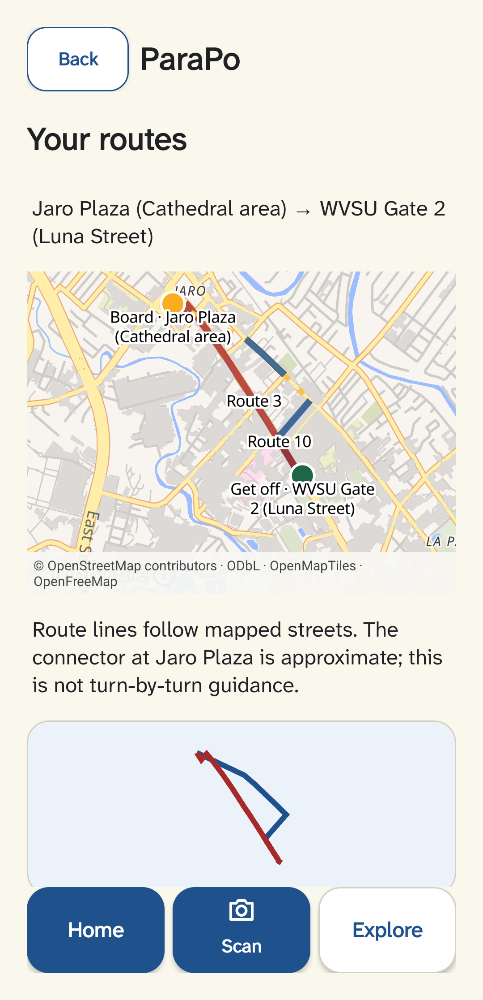

<p align="center">
  
</p>

<h1 align="center">ParaPo</h1>

<p align="center"><strong>Plan a direct jeepney ride across Jaro Plaza ↔ WVSU.</strong><br>
A small Android school demo for route planning in Iloilo City.</p>

<p align="center">
  
  
  
</p>

ParaPo lets someone choose two places and see which of the supported jeepney routes serves the trip directly. It combines a local route catalog, a live camera preview, and an interactive street map. There is no GPS tracking.

## At a glance

| | What works |
| --- | --- |
| **Plan** | Choose a start and destination manually. See eligible directions for Routes 3 and 10. |
| **Scan** | Use the **back camera** to read a frozen aligned crop, or explicitly try the experimental checked sign detector. Manual planning stays available. |
| **Explore** | Browse the supported route catalog without selecting a journey. |
| **Map** | Pan and zoom street maps in Results and Route Details; select a route to highlight its path and journey stops. |

<p align="center">
  
</p>

### Demo status

- **Camera preview:** works on the Tecno KJ8 and uses its back-facing camera. Camera permission is requested only when opening Scan. Frames stay on the device.
- **Recognition:** aligned snapshot reading is the default. **Try checked sign detector** enables the experimental v10 detector with sign selection and observed-vehicle direction confirmation. Same-input PyTorch/ONNX/Tecno parity passes on three development photos; roadside accuracy is unverified. ML Kit recovered correct codes from 4 of 9 labeled diagnostic crops; several legible crops remained unreadable. See [scanner evidence](docs/evidence/m4/scanner-2026-11-08.md).
- **Map:** MapLibre Native renders OpenFreeMap Liberty tiles, with streets and place labels. Fresh tiles need internet; a Retry action appears when the map cannot load.
- **Coverage:** only the Jaro Plaza–WVSU corridor on Routes 3 and 10, in four directional patterns. Dashed amber joins are unresolved source-map sections, not verified roads.

## Route coverage

The bundled catalog supports these journeys:

| Route | Jaro Plaza → WVSU | WVSU → Jaro Plaza |
| --- | --- | --- |
| **3** | Supported | Supported |
| **10** | Supported | Supported |

Results display eligible paths together. Choose a route to highlight it; Details shows that direction between the selected boarding and alighting stops. Stop order and route geometry remain in the local catalog.

The route street sequences follow the supplied Iloilo City Planning maps, with road geometry traced against OpenStreetMap data checked on 2026-11-08. Available sources do not establish the exact Route 3 Jaro Plaza boarding/return joins or the Route 10 Plaza approach and short Commission Civil–Del Carmen join. Those sections stay dashed and are described in the [source-map note](docs/evidence/m2/source-maps/README.md). This is corridor planning, not turn-by-turn guidance or a full route catalog.

## Map, network, and privacy

- Map tiles come from the [OpenFreeMap Liberty style](https://tiles.openfreemap.org/styles/liberty), rendered with [MapLibre Native for Android](https://maplibre.org/maplibre-native/android/). No map key or paid account is required for this demo setup.
- Map attribution is shown in the app and names OpenStreetMap contributors, OpenMapTiles, and OpenFreeMap. See [OpenStreetMap copyright and license](https://www.openstreetmap.org/copyright).
- Android `INTERNET` and `ACCESS_NETWORK_STATE` permissions are used for tiles and retry status. Camera permission is requested at Scan. Location permission is not used.
- Camera frames are not uploaded or saved by ordinary app use. If tiles are unavailable, route cards, markers, ordered stops, and the local schematic remain available. Cached tiles may be incomplete; there is no full offline basemap.

## Build and run

### Requirements

- Windows with JDK 17
- Android SDK platform 36 and a connected Android 14 / API 34+ device for phone checks
- The checked-in Gradle wrapper supplies Gradle 8.11.1

Set the Android SDK location in PowerShell, then build:

```powershell
$env:ANDROID_HOME = "$env:LOCALAPPDATA\Android\Sdk"
$env:ANDROID_SDK_ROOT = $env:ANDROID_HOME

.\gradlew.bat assembleDebug
```

Install or update the normal debug build on a connected phone:

```powershell
adb install -r .\app\build\outputs\apk\debug\app-debug.apk
```

The `-r` update keeps existing app data. The APK is a universal debug APK and includes native libraries for several device types.

### Checks

```powershell
.\gradlew.bat assembleDebug testDebugUnitTest
.\gradlew.bat -PparapoIsolatedUiTest connectedDebugAndroidTest
.\gradlew.bat assembleDebug assembleRelease
```

The isolated connected-test package uses `com.parapo.prototype.uitest`; it keeps tests that modify route data away from the normal phone installation. Rebuild `assembleDebug` without the isolated-test property before installing the demo APK. On the Tecno KJ8 / Android 14, the 2026-11-08 run passed 22 unit tests and 21 connected tests. See [camera and map test evidence](docs/evidence/m2/map-camera-2026-11-08.md).

### APKs

- Normal installable debug APK: `app/build/outputs/apk/debug/app-debug.apk`
- Unsigned release APK: `app/build/outputs/apk/release/app-release-unsigned.apk`

## Route data

Editable catalog source: `data/iloilo-jaro-wvsu.json`. Rebuild the packaged SQLite bundle after reviewing a route-data edit:

```powershell
python tools/build_route_bundle.py
```

Current dataset: `iloilo-jaro-wvsu-2026-11-08` (four directional patterns). On app startup, the validated packaged bundle upgrades an older installed catalog through `RouteBundleStore.replaceBundle`; an older bundle cannot replace newer data, and a failed update retains the last valid catalog.

## Recognition experiment

The [Nov. 9 OCR investigation](docs/evidence/m4/ocr-2026-11-09.md) compared crop padding, contrast, and character width on the Tecno. General preprocessing was not adopted because it regressed other saved signs. The shared reader now pads only inputs smaller than ML Kit's 32-pixel minimum, preventing a tiny crop from taking the recognition-failure path; it does not invent readable text.

The v10 model's recorded desktop discrepancy came from rectangular versus square inputs. Android's former Skia resize also differed from desktop OpenCV. Shared pixel-center bilinear preparation now produces exactly equal tensors on the Tecno, and decoded predictions pass the original 1.5px/0.02 parity limits on validation photos 28, 32, and 34. The detector still found only 2/3 signs with two false detections on these repeatedly inspected photos. No new training or test-set inference was run.

The default scanner uses **Aim -> Read aligned sign -> frozen crop**. Resume/reselect discards prior evidence. **Try checked sign detector** uses explicit sign selection and asks for the selected observed vehicle's direction when the text does not establish it. Two frames and overlap association do not prove physical ownership. Read [current evidence and diagnostic instructions](docs/evidence/m4/scanner-2026-11-08.md) before making performance claims.

An ignored local model asset remains optional for building preview, aligned OCR, and the manual planner. The checked experimental artifact is:

```powershell
Copy-Item datasets\m3-samples\runs\yolov8n-v10-320-20ep\weights\best.onnx app\src\main\assets\route-sign-yolov8n.onnx
```

Expected SHA-256: `e4aa74020c03cb4dbeef80cf54eb261eae95d3860235a84897dd9c47d574bdb2`. Older failed comparisons remain preserved; tolerances and thresholds were not relaxed. Missing or invalid detector assets leave preview, aligned reading, and manual planning available. Research images are excluded from normal APKs. The diagnostic screen is compiled only with `-PparapoIsolatedUiTest`; fixtures are transferred separately.

## Project notes

- [Figma design](https://www.figma.com/design/eTi2eZQ5W8FU6JJOTPUbjR/ParaPo?node-id=6-3) and [design implementation](docs/design-implementation.md)
- [Product requirements](docs/PRD.md) · [Research brief](docs/research-brief.md) · [Phase task tracker](docs/phasetask.md)
- [Route source maps and geometry gaps](docs/evidence/m2/source-maps/README.md) · [Phone screenshots and acceptance results](docs/evidence/m2/map-camera-2026-11-08.md)

ParaPo is a classroom prototype, not a production transit or navigation service. Schedules, transfers, other Iloilo routes, complete route geometry, reliable live-roadside recognition, and complete offline map coverage are outside the demonstrated claims.
